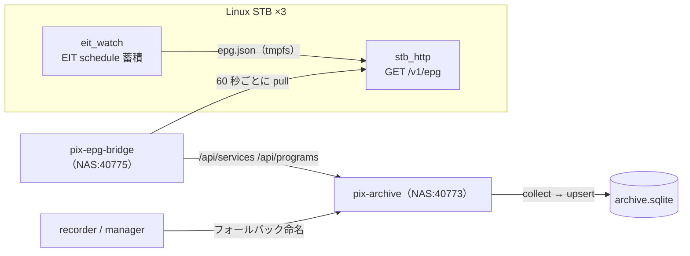

# EPG ホスト廃止の設計（mirakc /.40 依存の除去）

2026-11-22。全録システムの番組表（EPG）供給を mirakc（192.168.99.40 = PIX-SMB400）から
Linux STB 3 台の eit_watch が集めた EIT へ移す。この文書は設計を確定し、実装・配備・
検証の根拠を残す。元依頼は [prompts/epg-decommission-20261122.md](<../prompts/epg-decommission-20261122.md>)。

## 背景と目的

全録（録画 → NAS 保存 → CM カット）は Linux STB 3 台で運用中である。

| 台 | IP | 役割 | 受信 service |
| --- | --- | --- | --- |
| unit1 | 192.168.99.109 | PX-S1UD、テレビ静岡 ch17 | 35864（networkId 32195） |
| unit2 | 192.168.99.123 | DT295-CFW、BS09_0 | 211（networkId 4、BS11） |
| unit3 | 192.168.99.56 | DT295-CFW、SBS ch15 | 35856（networkId 32194） |

現状の EPG 供給は NAS 上の pix-archive が担う。pix-archive は mirakc
（192.168.99.40:40772）から `/api/services` と `/api/programs` を取得する。
取得結果を `archive.sqlite` に保存する。この依存は pix-archive.service の
`--mirakc` である。.40 は 2026-11-21 10:45 頃から ping 不通である。
カタログの最新 startAt は 11/17 14:50 のまま止まっている。監査は
`epg_stale`（96 時間超）を毎回報告している（docs/verification-20261122.md §6）。

EPG の消費者は 3 系統である。

- recorder（nas/src/pix_stream_recorder.c）のフォールバック命名。`find_service_by_id`・
  `find_service_by_channel`・`find_program_by_clock` が `/api/archive/services` と
  `/api/archive/programs` を使う。
- manager（pix_stream_manager.c）。放送局名のキャッシュに
  `/api/archive/services` を使う。
- 監査（pix-recording-audit.py）。`archive.sqlite` の `max(start_at)` を見て、
  6 時間より古いと `epg_stale` を報告する。

録画の番組名そのものは STB が実受信した EIT から来る。EPG 停滞の影響は
カタログ表示とフォールバック命名に限られる。

目的は mirakc・.40・ADB 依存をすべて除去することである。そのうえで、STB の
eit_watch が集めた EIT からアーカイブ EPG（カタログ + recorder フォールバック）を
供給する。録画 3 台を止めず、11/21〜22 の既存修正を壊さない。

スコープは次のとおりである。STB 側の eit_watch と stb_http。NAS 側の EPG 供給経路と
pix-archive 接続。監視の接続先。スコープ外は次のとおりである。mirakc・.40 本体の復旧。
録画・CM 処理経路の変更。番組詳細（extended / genres / 出演者）の供給。
録画対象外の他局番組表。既存 DB の過去データ削除。

## 制約

録画 3 台の稼働系に触るため、次を守る。

| 制約 | 内容 |
| --- | --- |
| 録画の継続 | manager 再起動で録画が切れても、同一フォルダの次パートで続く |
| STB の RAM rootfs | ランタイム変更は再起動で消える。再ビルド → 焼き直し → 再起動 |
| STB 再起動 | 破壊的操作のため必ずユーザー確認を取る |
| ストレージ方針 | STB は RAM 上処理・tmpfs 完結・中間ディスク書き込みなし |
| 正規ソース | NAS 側の C と py は repo の `nas/src/` が唯一の正である |
| テスト | `tests/`（274 件、2026-11-22 全 OK）に回帰を追加して守る |
| 既存修正 | 11/21〜22 の修正（docs/verification-20261122.md）を退避させない |

## 方式の選択

### 収集経路は eit_watch の蓄積と HTTP 公開（案 A）

元依頼の候補 A / B / C を、スケジュールの深さ、所有者、STB 側の負担で比較した。

| 案 | 概要 | 評価 |
| --- | --- | --- |
| A | eit_watch が蓄積し `GET /v1/epg` で公開。NAS が取得 | 数日分。EIT 解析の所有者は eit_watch に集約 |
| B | NAS が pix-ring（生 TS 約数分）を取得して解析 | STB 変更不要だが NAS に重複した解析者を作る |
| C | eit_watch が NAS へ push | STB に HTTP クライアントと障害時保持を置く |

案 A を採用する。理由は次のとおりである。

- 本日、eit_watch.c のキャッシュ構造を確認した。保持しているのは現在番組 1 件
  （g_last）と、イベント ID ごとの番組名キャッシュ 64 スロットだけである。
  開始時刻・長さ・未来のイベントは保持していない。そのため案 B でも NAS 側に
  スケジュールの解釈者を新しく作る必要があり、案 A の STB 側変更と同程度の
  新規コードになる。
- eit_watch は常時 TS を流しながら EIT schedule 表（table_id 0x50–0x5f）を
  受けている。表を蓄積すれば番組表は数日分まで届く。案 B のリングは数分分しかないが、
  解析を常時続ける案 A はこの制限を受けない。
- STB に curl はなく wget のみである。push（案 C）は STB 側に NAS 障害時の
  バッファリングとリトライを持たせる必要がある。案 A なら NAS が pull するので、
  STB はファイルを書くことと既存 HTTP サーバで公開することだけで済む。
- EIT の解析は eit_watch が唯一の所有者である（package/stb-streamer/src/eit_watch.c）。
  案 B は NAS 側に TS セクション再構成と EIT パーサの複製を作り、所有者を
  2 つに増やす。tests/test_eit_sections.c が実解析コードを直接結合するテスト基盤を
  持つのは案 A だけである。

案 A の代償は、STB 側変更に伴うイメージ再ビルド・焼き直し・再起動が 3 台分
必要なことである。unit2 は 2026-11-22 に同じ手順を完了している。unit1 / unit3 の
再起動にはユーザー確認を取る。

### 供給は NAS 側ブリッジと pix-archive の最小改修

pix-archive の役割は 3 つある。collect は 300 秒ごとに mirakc から
`/api/services` と `/api/programs` を取得し、DB へ upsert する。
ingest は録画 sidecar を取り込む。配信は `/api/archive/*` と `/media/*` を応答する。
正規ソースは本日 `/home/ku/pix-archive-20261029/repo/src/archive/pix-archive.c`
で確認した。実行中バイナリ（11/10 14:20）と .c の更新（11/10 14:19）が一致する。
deps は同リポジトリ配下の `work/program-recording-implementation-20261029/deps`
にある。build スクリプトは `scripts/build_pix_archive.sh` である。git 管理はない。

| 案 | 概要 | 評価 |
| --- | --- | --- |
| ブリッジ | NAS で STB の `/v1/epg` を取得し、mirakc 互換 API を提供 | collect / ingest / API は無改修 |
| 直接改修 | pix-archive が 3 台の `/v1/epg` を直接取得してマージ | 局名の対応表を pix-archive に置く |

ブリッジを採用し、pix-archive には `--mirakc` フラグの名称変更のみ入れる。
理由は次のとおりである。

- 局名・チャンネル番号・networkId の対応は STB 単位の配備構成である。
  どの unit がどの局を受けるかはイメージの defaults が決める。この対応表の
  所有者をブリッジの設定とし、pix-archive はカタログ DB と配信 API の所有者の
  ままにする。
- mirakc 互換 JSON への変換（serviceId と networkId からの合成 ID など）を
  1 か所に集める。recorder と manager は `/api/archive/*` だけを見るため無改修である。
- `--mirakc` の名称は収録基準 4（NAS 内の mirakc 参照ゼロ）に抵触する。そこで
  pix-archive.c の引数名とエラーメッセージを `--epg` / 「EPG ソース」に変える。
  collect ロジック自体は変更しない。

## 設計

### データの流れ

EPG の対象範囲は録画対象 3 局に縮む。各 STB は自トランスポンダしか受けておらず、
番組表も自 service の EIT しか届かない。録画対象（テレビ静岡 / BS11 / ＳＢＳ１）と
一致するため要件を満たす。既存 DB の他局の airings は過去データとして残す。
新規収集が止まるだけで、削除はしない。

### STB 側: eit_watch のスケジュール蓄積と /v1/epg

eit_watch.c にスケジュールキャッシュを追加する。既存の現在番組選択（g_last）と
名前キャッシュの動作は変えない。

| 項目 | 設計 |
| --- | --- |
| 収集対象 | 自 service の EIT（0x4e と 0x50–0x5f） |
| 保持項目 | event_id、startAt（ms）、duration（ms）、name |
| 上限 | 2048 件。満杯時は startAt が最も古いものを追い出す |
| 間引き | 書き出し時に 24 時間より古く終わったものを捨てる |
| 出力 | `/dev/shm/pix/epg.json`。変更時に 30 秒以下の間隔で書く |
| 形式 | serviceId、generatedAt、events の配列 |

細部は次のとおりである。

- 3 分未満のイベントは収集しない。現行の現在番組選択と同じ基準で、番宣などの
  短い項目が番組境界としてカタログに入るのを避ける。
- name は 0x4d（short_event_descriptor）を arib_text.c で UTF-8 化する。
  同一 event_id の表が後から名前を届けたら上書きする。現行の名前キャッシュと
  同じ扱いである。
- 書き出しは tmp ファイルへの書き込みと rename による原子置換である
  （現行の state_write と同じ）。

stb_http.c に `GET /v1/epg` を追加する。`/v1/program` と同じファイル返しの
パターンである。大きさは stat で確かめてから確保する。上限は 1 MiB、
型は application/json とする。パスは stb_linux_pipe.c の設定に `.epg_path` を
追加し、既定値を `/dev/shm/pix/epg.json` にする。メモリは BSS に上限 2048 件分
（約 0.6 MiB）、epg.json は約 0.2 MiB である。各機の空き RAM（unit1 で 1.3 GiB 以上）
に対して十分小さい。

### NAS 側: pix-epg-bridge

新規の正規ソース `nas/src/pix-epg-bridge.py`（Python 3 標準ライブラリのみ）を
systemd ユニット `pix-epg-bridge.service` で動かす。127.0.0.1:40775 で待つ。

| 項目 | 設計 |
| --- | --- |
| 局設定 | 3 局の対応表をコード内に持つ |
| 取得 | 60 秒ごとに 3 台の `GET /v1/epg`。timeout 10 秒、直列 |
| 保持 | 各局の最後の成功データ。失敗時は前回データを提供し、ログに残す |
| `/api/services` | 局設定から mirakc 形で応答 |
| `/api/programs` | 各局の events を mirakc 形に変換して結合 |
| `/api/tuners` と `/api/version` | 空配列と簡易オブジェクト（旧 miraview は運用外） |
| ログ | JSON 行を stdout へ（journald） |

局設定の対応表の項目は host・serviceId・networkId・name・channel である。
mirakc 形への変換規則は次のとおりである。

- service の id は `networkId×100000 + serviceId`。program の id は
  `networkId×10^10 + serviceId×10^5 + eventId`。いずれも mirakc の合成規則である。
- program には `eventId`、`serviceId`、`networkId`、`startAt`、`duration`、
  `isFree: true`、`name` を含める。pix-archive が参照する項目はこれで足りる。

局設定の初期値は archive.sqlite の services から確認済みの値である。
テレビ静岡: id 3219535864、channel `{type: GR, channel: 17}`。BS11: id 400211、
`{type: BS, channel: BS09_0}`。ＳＢＳ１: id 3219435856、`{type: GR, channel: 15}`。

### pix-archive への接続変更（--epg）

pix-archive.c は collect と live proxy の参照先を `--mirakc` から `--epg` に
名前を変える。既定 URL は `http://127.0.0.1:40775` にする。fetch 対象のパス
（`/api/services`、`/api/programs`）と live proxy の 4 パスは変わらない。
ブリッジが同じパスを提供する。名前変更後は `scripts/build_pix_archive.sh` で
NAS 上ビルドし、旧バイナリを退避して systemd ユニットの ExecStart を書き換える。

### 監視・監査

監査（pix-recording-audit.py）の `check_epg` は `max(start_at)` が 6 時間より古いと
`epg_stale` を出す。未来の番組表が入ると age が負になり警告は出ない。
判定の変更は不要である。収集停止は、未来分が消化された時点で再び警告される
（既存の安全網）。

pix-stb-health.py は adb 時代（Android STB）の watchdog モニターである。
現在の 3 台はすべて `adb: unavailable` を返す。監査はこの status.json を summary の
`stb_health` に載せ、TIMERS に `pix-stb-health.timer` を持つ。
単純な停止は監査の timer 修復と衝突する。そこで監査スクリプトを repo に
canonical 化する。`pix-stb-health.timer` を TIMERS から外し、`STB_HEALTH` の
読み込みを除く。そのうえで pix-stb-health を無効化する（ユーザー確認）。

pix-stb-guard.py は Android 復旧経路（adb reboot、com.example.dtvandroid 再起動、
adb カウンタ）を持つ。正規ソースは nas/src/pix-stb-guard.py であり、NAS 配置物と
一致することを本日確認した。監視対象は 3 台の Buildroot（SSH 復旧）のみで、
これらの経路は死んでいる。収録基準 4 のため除去する。
`NO_REBOOT_HOSTS = {'192.168.99.40'}` も一緒に除く。除去後は guard の self-test と
既存テストで守り、NAS へ再配備する。

## 障害時の動作

| 障害 | 動作 |
| --- | --- |
| STB 1 台が死ぬ | bridge はその局の前回データを提供し続ける。録画は guard が復旧 |
| bridge が死ぬ | pix-archive の collect が失敗し、DB は凍結。6 時間後に `epg_stale` |
| STB の epg.json が無い | bridge はその局の events を落とし、残り局を続ける |
| スケジュールが浅い | bridge は届いた分だけ DB へ入れる。命名は EIT 実受信名が優先 |
| pix-archive 再起動 | 録画は stopped にならない（archive は録画経路から独立） |

スケジュールが浅い場合の影響の根拠: recorder の公開命名は STB の pixb 番組名
（seg->name）を第一に使う。archive EPG は接続直後など pixb メタデータが無いときの
フォールバックである（pix_stream_recorder.c の 908 行目付近）。

## 配備と後処理

### 配備順序

1. repo 実装と tests 追加 → 全テスト実行。
2. bridge を NAS へ配備して起動。この時点で STB の `/v1/epg` は未供給のため
   events は空である。
3. STB イメージを NAS の docker で `X96MAX_UNIT=1/2/3` で再ビルド →
   docs/ram-rootfs.md の手順で焼き直し → 再起動はユーザー確認 →
   `/v1/epg` がデータを返すことを確認。
4. pix-archive を再ビルドし、ユニットの `--mirakc http://192.168.99.40:40772` を
   `--epg http://127.0.0.1:40775` に書き換えて再起動。collect が bridge を見に行く。
5. `archive.sqlite` の airings に 3 局の未来の番組が入ることを確認。
6. 後処理（次節、ユーザー確認）→ 網羅 grep → 監査と録画の確認 → docs とメモ。

### ユーザー確認事項

破壊的な操作の一覧である。実施前に個別に確認を取る。

| 操作 | 内容 |
| --- | --- |
| STB 再起動 | unit1 / unit2 / unit3（焼き直し後） |
| pix-epg-window 無効化 | timer と service を停止し、epg_window.py を削除 |
| pix-stb-health 無効化 | timer と service を停止し、スクリプトを退避 |
| pix-stb-guard の改修 | 死んだ Android 復旧経路のコード除去と再配備 |
| 旧コピーの整理 | mirakc・.40・adb 参照を含む旧バックアップと履歴ワークスペースの削除または退避 |
| pix-archive 旧バイナリ | `--mirakc` 世代の退避物（.prev / .bak / .before-*）の整理 |

旧コピーの整理の対象は本日の調査で確定した。

- `/home/ku/pix-stream-20261101` の guard .bak 類と stale-sources
- `/home/ku/pix-archive-20261029` の .bak 類と candidate / staging / miraview 退避物
- `/home/ku/pix-record-control-tests-20261029` と `pix-ts-*` の履歴ワークスペース

実施時に個別の一覧を示して確認する。

## 影響とリスク

カタログは 3 局に縮む。番組詳細（extended 等）は供給されなくなる。現状も .40 障害で
供給停止中である。`/api/archive/services` は 3 局のみになり、manager の放送局名
キャッシュと recorder のフォールバックは 3 局で機能する。DB の他局 airings は
残るため、`/api/archive/programs` の全体参照は過去分を含み続ける。

後戻り性は次のとおりである。STB は旧イメージを焼くだけで戻せる。unit2 は本日
`work/backup-unit2-boot-20261122/` へ退避済みである。NAS 側は pix-archive 旧バイナリと
ユニットの書き換えで戻せる。bridge の停止は戻し操作の一部である。

リスクは STB 再起動時の録画分断と、unit1 / unit3 の再起動後の挙動が未検証である
ことである。録画分断は次パート継続で吸収する（11/22 の partId 修正済み）。
再起動は 1 台ずつ、確認後に行う。

## 未解決点

- STB イメージ再ビルドの identity 転送。11/22 の unit2 再ビルドの実手順
  （NAS 側への identity 配置方法）は docs/build-on-nas.md の rsync 手順に書かれて
  いない。配備時に docs/verification-20261122.md の記録と実環境から確認する。
- EPG の schedule の深さは放送局の運用に依存する（目安として数日）。届いた分だけ
  供給する。収録基準 1 の「今後数日分」の判定は配備後の実データで確認する。
- recorder フォールバックの実機シミュレーションは行わない。録画フォルダへ
  実ファイルを作るためである。tests/ での検証と、自然発生する接続断 → 再接続時の
  命名観察で代替する。
